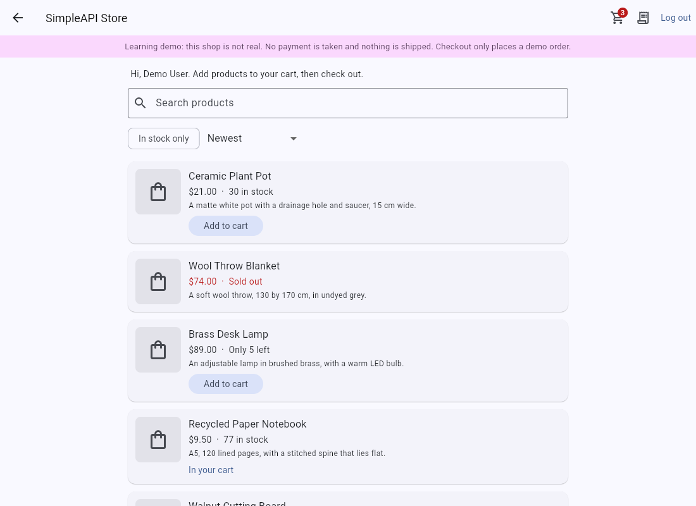

# SimpleAPI Store API: Flutter web sample

A small Flutter web app that shows how to call the free [SimpleAPI Store API](https://store.simpleapi.dev/docs) from a browser, with no backend of your own.

**[Live demo](https://simple-api-dev.github.io/store-client/)** | **[API docs](https://store.simpleapi.dev/docs)** | **[Get a free key](https://keys.simpleapi.dev/?product=store)**



## Run it

You need the [Flutter SDK](https://docs.flutter.dev/get-started/install) (stable; CI uses 3.47.8) and a free key from [keys.simpleapi.dev](https://keys.simpleapi.dev/?product=store).

```bash
git clone https://github.com/simple-api-dev/store-client
cd store-client
flutter pub get
flutter run -d chrome --dart-define=SIMPLEAPI_KEY=YOUR_KEY
```

The live demo opens on the catalog, which needs only the key, with a **Try the demo account** button: one click logs in as a shared demo user, with no registration and no key handling. Run the tests with `flutter test`. All HTTP is mocked, so nothing calls the real API.

This is a learning demo. The shop is not real: there are no payments and no payment fields anywhere, and checkout only places a demo order. The app says so on every screen.

## How it calls the API

Your API key goes in the `apikey` query string. That is all the catalog needs. A logged-in user's cart and orders also need a bearer token.

```dart
// The catalog: the key alone.
final catalog = Uri.https('store.simpleapi.dev', '/api/products', {'apikey': apiKey, 'q': 'mug', 'sort': 'price'});
final response = await http.get(catalog, headers: {'Accept': 'application/json'});

// Your cart: the key and a bearer token.
final mine = Uri.https('store.simpleapi.dev', '/api/users/$userId/cart', {'apikey': apiKey});
final yours = await http.get(mine, headers: {
  'Accept': 'application/json',
  'Authorization': 'Bearer $token', // omitted for login and register
});
```

Every call lives in [`lib/store_api.dart`](lib/store_api.dart), one method per endpoint. The rest of the app never touches HTTP.

## Screens and API calls

| Screen | What it does | Calls |
| --- | --- | --- |
| **Shop** (`shop_screen.dart`) | The catalog with name, price, stock and description. Search, an in-stock filter and a sort. Logged out it offers **Try the demo account** as the main action, and **Create an account** and **Log in**. Logged in it adds a product to the cart. The back arrow returns to simpleapi.dev. | `GET /api/products` |
| **Product** (`product_screen.dart`) | One product with its full description and a quantity to add to the cart. | `GET /api/products/{id}`, `POST /api/users/{user_id}/cart` |
| **Cart** (`cart_screen.dart`) | Change a quantity, remove an item, see the total and **Place order**. | `GET /api/users/{user_id}/cart`, `PUT /api/users/{user_id}/cart/{id}`, `DELETE /api/users/{user_id}/cart/{id}`, `POST /api/users/{user_id}/orders` |
| **Orders** (`orders_screen.dart`) | Your orders with their items and status. A placed order can be cancelled. | `GET /api/users/{user_id}/orders`, `POST /api/users/{user_id}/orders/{id}/cancel` |
| **Log in / Register** (`auth_screen.dart`) | Get a token, or **Try the demo account**. **Log out** is in the app bar. | `POST /api/users/register`, `POST /api/users/login`, `POST /api/users/logout` |
| **Reset password** (`forgot_screen.dart`) | Email a 6-digit code, then send it with a new password. | `POST /api/users/forgot`, `POST /api/users/reset` |

`{user_id}` is always the logged-in user's own id, taken from the `user` object in the register or login answer. The API has more endpoints than this sample uses, such as reading one cart item or one order, changing or deleting your account and the admin calls that manage products and orders. See the [full docs](https://store.simpleapi.dev/docs).

## Use your own key

The live demo is built with a shared demo key. The app has no screen for entering a key: it uses only the key compiled in at build time. To run it with your own, pass it to Flutter:

```bash
flutter run -d chrome --dart-define=SIMPLEAPI_KEY=YOUR_KEY
```

Get a free key at [keys.simpleapi.dev](https://keys.simpleapi.dev/?product=store).

## Good to know

- Every error is JSON, `{"message": "..."}`. The app shows readable text for 400, 401, 403, 404, 409, 422, 429 and 503.
- Login and register answer `{"token": "...", "expires_at": "...", "user": {...}}`. A token lasts 30 days, and logging out ends only this session.
- A list answers `{"data": [...], "total": 42, "page": 1, "per_page": 25}`. This app asks for `per_page=100`, the most a page can hold, and shows **Load more** if there is another page. The cart list also answers `total_cents`, the total of the whole cart.
- Prices come in whole cents (`price_cents`). The app shows them as dollars with two decimals, so 1800 is $18.00.
- `GET /api/products` lists active products only, newest first. `?q=` looks in the name and description, `?in_stock=true` keeps products in stock, and `?sort=` is `price`, `-price` or `name`. The search waits for a pause in typing, to stay within the rate limit.
- `image_url` can be `null`. The app then shows a simple placeholder, and the same placeholder if the picture does not load.
- A product that is not for sale answers `404`, on the product itself and when you add it to a cart.
- A cart holds a product once. Adding it again answers `409`, so the app changes the quantity with `PUT` instead. A quantity is 1 to 99. The cart checks no stock: checkout does.
- Checkout (`POST /api/users/{user_id}/orders`, with an empty body) turns the cart into an order, checks and reduces the stock and empties the cart, all or nothing. An empty cart answers `422` and too little stock `409`, both with a clear message. The order keeps its own copy of each name and price.
- An order is `placed`, `shipped` or `cancelled`. Only a placed order can be cancelled, which puts its stock back. Any other order answers `409`. Nothing is paid, so nothing is refunded. The app loads the catalog again after a checkout or a cancel, so the stock it shows is current.
- A bad or missing key answers `401`. So does a dead token; the app then logs you out and shows the catalog. A failed login is also a `401` ("Invalid email or password.") and is shown on the form.
- Login and register never send the bearer token. The catalog never sends it either.
- A new user, cart item or order answers `201`. Registering an email that is already taken answers `409`.
- A key holds 25 users, 100 products, and each user may have 100 orders. The call that would go over answers `403`.
- Passwords need at least 8 characters.
- The API allows 60 requests a minute per IP address. More answers `429`.
- The demo account is `demo@simpleapi.dev` with password `try-the-demo`. It is public by design and shared by every visitor, and the live demo resets every night, so do not use a real password or any private details. When the demo key has no room for more users, registering shows "The demo is full. It resets every night." The API refuses `users/forgot` and `users/reset` for it with `403` `The demo account cannot be changed.`, and the app shows that message.

## Project layout

```
lib/store_api.dart        the whole API client
lib/models.dart           Product, CartItem, Order, ListPage and ApiException
lib/app_state.dart        the logged-in user, demo login and the cart (a ChangeNotifier)
lib/open_url*.dart        opens the SimpleAPI home page (the back arrow)
lib/config.dart           the build-time key (SIMPLEAPI_KEY) and the demo account
lib/screens/              the screens, and ui.dart with shared widgets, money and error wording
test/                     unit tests for the client, widget tests for the app
```

## Deploy to GitHub Pages

[`.github/workflows/pages.yml`](.github/workflows/pages.yml) runs on every push to `main`. It runs `flutter analyze` and `flutter test`, builds with `flutter build web --release --base-href /store-client/`, and publishes with the official Pages actions.

In your own copy:

1. Set **Settings, Pages, Source** to **GitHub Actions**.
2. Add a repository **variable** named `SIMPLEAPI_KEY` under **Settings, Secrets and variables, Actions, Variables**. The build passes it with `--dart-define=SIMPLEAPI_KEY=...`.
3. Push to `main`, or run the workflow.

Anything passed with `--dart-define` ends up in the compiled JavaScript, so anyone can read it from the deployed site. Use a free key made for a public demo. If you rename the repository, change `--base-href` to match.

## License

[MIT](LICENSE)
